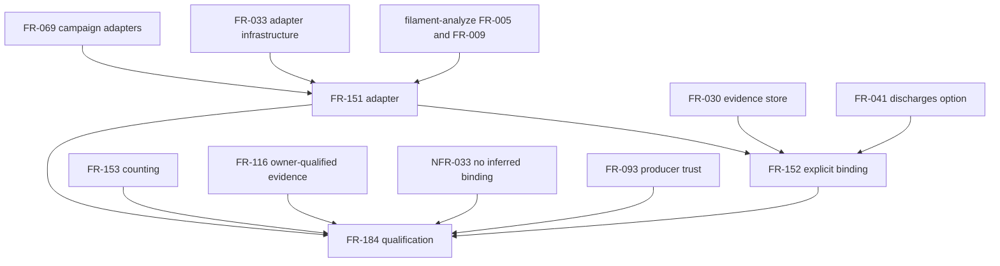

## Summary

Dependency analysis for the changed FR-151/FR-152/FR-184 chain found an acyclic order. Upstream producer contracts and adapter infrastructure enable FR-151; FR-151 plus the store and recorder contracts enable FR-152; FR-116, FR-151/152/153, NFR-033 and FR-093 are prerequisites for the FR-184 qualification definition. AP-201 and AP-202 are active but do not apply to this adapter protocol migration.

## Findings

| ID | Severity | Summary | Refs |
|----|----------|---------|------|
| FND-001 | low | No dependency ordering defect or cycle found in the reviewed change. | FR-151; FR-152; FR-184 |

### Classification

| Requirement | Class | Rationale |
|-------------|-------|-----------|
| FR-151 | Feature | Reads and transcribes producer reports through the registered differential-report adapter. It depends on filament-analyze FR-005/FR-009 and existing adapter infrastructure FR-033/FR-069. |
| FR-152 | Feature | Records explicit obligation bindings from `--discharges`. It depends on FR-151, the FR-030 store, FR-033, FR-041, and the execution evidence contract in ADR-100. |
| FR-184 | Feature | Defines when analysis evidence qualifies for a positive decision. It depends on FR-116, FR-151/FR-152/FR-153, NFR-033, FR-093, and the referenced upstream producer/executor contracts. |

### Dependency Graph

### Topological Order

1. Producer contracts (filament-analyze FR-005/FR-009) and existing enablement (FR-030, FR-033, FR-041, FR-069, FR-093, FR-116, FR-153, NFR-033).
2. FR-151, once its producer and adapter prerequisites are available.
3. FR-152, after FR-151 and its store/recorder prerequisites.
4. FR-184, after FR-151/152/153 and its assurance prerequisites.

### Cycles

None detected.
