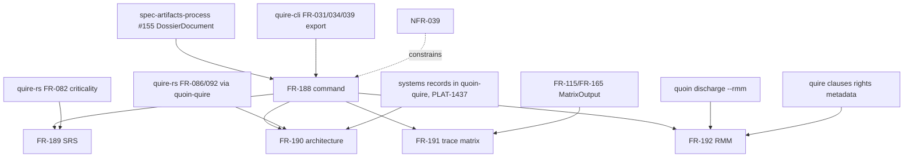

## Summary

Ticket: PLAT-1436. Separated enablement from feature work, and checked each
upstream contract the spec consumes against its source. The upstream specs were
read through `gh api` from agent-ix/quire-cli and agent-ix/quire-rs; quoin's
code was read in place.

### Classification

| Requirement | Class | Rationale |
| --- | --- | --- |
| FR-188 | Feature + enablement | The command surface that the four document generators plug into. Needs the DossierDocument archetype (spec-artifacts-process #155, open) and `quire export` (quire-cli FR-031/034/039). |
| FR-189 | Feature | Needs the requirement documents and quire-rs FR-082 criticality (landed). |
| FR-190 | Feature, blocked on enablement | Needs quire-rs FR-086/FR-092 (exposed in `quoin-quire`) and the systems records (not exposed; PLAT-1437). |
| FR-191 | Feature | Needs quoin FR-115/FR-165 `MatrixOutput`. |
| FR-192 | Feature | Needs `quoin discharge --rmm` (`requirements-mapping-v1`) and `quire clauses` rights metadata. |
| NFR-039 | Constraint | Applies across FR-188..FR-192. |

### Dependency Graph

### Topological Order

1. The DossierDocument archetype (#155), plus the existing quire export, FR-082, FR-086/092, FR-115/165 and discharge RMM.
2. FR-188.
3. FR-189, FR-191 and FR-192, in parallel. FR-190 after the PLAT-1437 systems-record exposure.

### Cycles

None.

## Verdict

FAIL. Two upstream contracts do not provide what the spec consumes from them
(FND-001 and FND-002).

## Findings

| ID | Severity | Summary | Refs |
| --- | --- | --- | --- |
| FND-001 | high | FR-191 renders criterion "statement" and "criticality" from the `quoin matrix` `MatrixOutput`, and AC-5 requires criticality "as the matrix reports them". `MatrixOutput` emits neither. Measured `quoin matrix --json` criterion keys are `analysis_evidence`, `binders`, `evidence_detail`, `evidence_status`, `id`, `method`, `static_status`. `criticality` and `statement` exist only on the input-side `MatrixCoverageRequirement`/`MatrixCoverageCriterion` ("retained in the reader shape but not rendered"). AC-5 cannot pass against the cited source. | spec/functional/FR-191-dossier-trace-matrix-content.md:22; spec/functional/FR-191-dossier-trace-matrix-content.md:51; rust/crates/quoin-assurance/src/matrix.rs:66; rust/crates/quoin-assurance/src/matrix.rs:83; rust/crates/quoin-assurance/src/matrix.rs:139 |
| FND-002 | high | FR-188 makes `export` always run `quire export` "as one bundle" with `--bundle-title` and `--bundle-id`. quire-cli FR-039-AC-7 refuses "`--bundle-title` with one input" with exit 3. `quoin dossier export --doc srs`, or any one-document selection, therefore always fails with exit 4. The spec allows `--doc` on export but never states single-document behavior. | spec/functional/FR-188-dossier-command.md:40; spec/functional/FR-188-dossier-command.md:26; spec/functional/FR-188-dossier-command.md:85 |
| FND-003 | medium | FR-192 renders restricted clauses as "id and status only" using the rights metadata of `quire clauses`. Its Inputs list only `quoin discharge ... --rmm --json`, whose `RmmRow` has no clause text and no rights member (`clauseId`, `force`, `applicability`, `compliance`, `reason`, `evidenceRefs`, `tailoringDescription`, `tailoringRationale`). Where the rights metadata, and any clause text, come from is unstated, so FR-192-AC-4 has no defined input. | spec/functional/FR-192-dossier-rmm-content.md:25; spec/functional/FR-192-dossier-rmm-content.md:43; spec/functional/FR-192-dossier-rmm-content.md:55; rust/crates/quoin-assurance/src/discharge/rmm.rs:93 |
| FND-004 | low | FR-188 requires the frontmatter of the `DossierDocument` archetype, which comes from spec-artifacts-process PR #155 (open, unmerged). Its Dependencies Upstream line omits it and lists only quire-cli. | spec/functional/FR-188-dossier-command.md:52; spec/functional/FR-188-dossier-command.md:92 |
