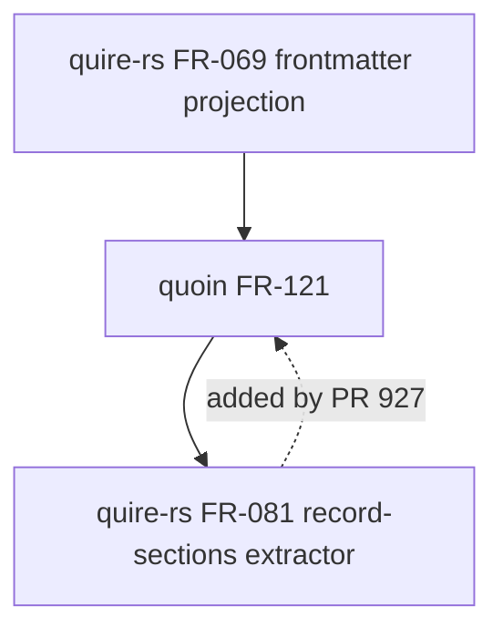

## Summary

Ticket: PLAT-1441. Dependency analysis of the two `depends_on` edges quoin PR #927
(`0799418e`) adds to FR-121: `ix://agent-ix/quire-rs/FR-069` and
`ix://agent-ix/quire-rs/FR-081`. Both targets exist on quire-rs `main`
(`spec/functional/FR-069-semantic-module-contract-at-load.md`,
`spec/functional/FR-081-record-sections-extraction.md`). The form matches the
repo's existing cross-repository edges (e.g. `ix://agent-ix/quire-rs/FR-054`).

## Verdict

**CONDITIONAL.** The FR-069 edge is correct: FR-069 defines the
`frontmatter_field` projection that FR-121's ownership rule builds on. The
FR-081 edge points the wrong way.

## Coverage

Examined: FR-121 frontmatter `relationships` (new FR-069 and FR-081 entries) and
the Dependencies section (new "Upstream, quire-rs" bullet; existing
"Downstream: the extractor in `agent-ix/quire-rs`"). Context: quire-rs FR-081
Description ("The grammar follows `agent-ix/quoin` FR-121") and Dependencies
("Upstream: ... `agent-ix/quoin` FR-121, FR-122, FR-123"); quire-rs#688.

### Classification

| Requirement | Class | Rationale |
|-------------|-------|-----------|
| quire-rs FR-069 | Enablement | Projects frontmatter to the record key and validates it; FR-121 builds on it. |
| quoin FR-121 | Feature | Defines section ownership and diagnostics for frontmatter-owned keys. |
| quire-rs FR-081 | Feature (implementation) | Implements FR-121 in the engine ("Per `agent-ix/quoin` FR-121"). |

### Dependency Graph

### Cycles

FR-121 → quire-rs FR-081 (new `depends_on`) and quire-rs FR-081 → FR-121
(FR-081's Upstream, and FR-121's own Downstream "the extractor in
`agent-ix/quire-rs`") form a cycle.

## Findings

| ID | Severity | Summary | Refs |
| --- | --- | --- | --- |
| FND-001 | medium | The new `depends_on` edge to quire-rs FR-081 makes a dependency cycle. FR-081 implements FR-121, lists quoin FR-121 as Upstream, and is already FR-121's Downstream ("the extractor in `agent-ix/quire-rs`"). The ownership grammar is Quoin's to define, so FR-081 is downstream. Drop that edge and keep the FR-069 edge. | spec/functional/FR-121-record-key-sections-mapping.md:18 |
| FND-002 | low | The "Upstream, quire-rs" bullet says FR-069 and FR-081 hold "the `frontmatter_field` locator whose ownership this requirement defines". On quire-rs `main` neither defines frontmatter-owned record keys yet; that text is in open quire-rs#688. The bullet does not say the upstream is pending, so a reader following the link finds no such locator rule. | spec/functional/FR-121-record-key-sections-mapping.md:147 |

## Dispositions

Round 1, FR-121 at `21db2ff6`. No new findings from this method. The FR-081 `depends_on` edge is gone. FR-121's only quire-rs typed edge is `depends_on` FR-069. FR-069's typed edges run within quire-rs (they include `requires` FR-081). FR-081 at quire-rs#688 head `7b43672f` has no typed edge to quoin FR-121, only its prose Upstream. So the typed graph has no cycle. The prose path FR-121 → FR-069 → FR-081 ⇢ FR-121 comes from FR-069's existing `requires` FR-081 on quire-rs `main`. This PR did not add it.

| FND | outcome | reason |
| --- | --- | --- |
| FND-001 | fixed | The `depends_on` edge to quire-rs FR-081 was removed. FR-081 is now named only as Downstream ("which implements this requirement"). |
| FND-002 | fixed | The Upstream bullet now cites only FR-069 and says its frontmatter-owned text is pending in quire-rs PR #688. The Downstream FR-081 mention says the same. |

- FND-001 after_excerpt (`spec/functional/FR-121-record-key-sections-mapping.md:16-17`): `- target: "ix://agent-ix/quire-rs/FR-069"` / `type: "depends_on"` (no FR-081 entry follows)
- FND-002 after_excerpt (`spec/functional/FR-121-record-key-sections-mapping.md:156`): `**Upstream, quire-rs**: [FR-069](ix://agent-ix/quire-rs/FR-069), the frontmatter_field locator and its projection of the frontmatter value; its frontmatter-owned key text is pending in quire-rs PR #688`
