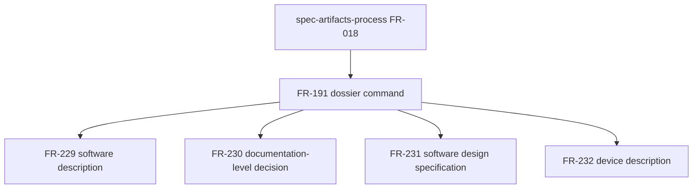

## Summary

The written dossier-document dependencies form an acyclic order: the shared DossierDocument contract supports FR-191, which supplies the command frame and registration order for FR-229–FR-232. The DAG is incomplete because the source-record schemas consumed by three of the four new features have no owning requirement.

## Classification

| Requirement | Class | Rationale |
| --- | --- | --- |
| spec-artifacts-process FR-018 | Enablement | Shared DossierDocument frontmatter and producer-identity contract. |
| FR-191 | Enablement | Common command, document registration, ordering, and gap contract used by the content generators. |
| FR-229 | Feature | Produces the software description document. |
| FR-230 | Feature | Produces the person-authored documentation-level decision document. |
| FR-231 | Feature | Produces the software design specification document. |
| FR-232 | Feature | Produces the device description document. |

## Dependency Graph

## Topological Order

1. FR-018.
2. FR-191.
3. FR-229, FR-230, FR-231, and FR-232 can proceed in parallel after the common command contract and their source contracts are available.

## Cycles

No cycle is present in the declared prerequisite edges.

## Findings

| ID | Severity | Summary | Refs |
| --- | --- | --- | --- |
| FND-001 | medium | The graph has no prerequisite requirement for the input-record contracts used by FR-229, FR-230, and FR-232. | FR-229, FR-230, FR-232 |

## Evidence

The Quoin catalog has no `software_description`, `documentation_level_decision`, or `device_description` object type, and the spec contains no source-model FR for these records. The new document generators therefore depend on an unowned source-contract prerequisite; define it or link to an existing validated contract before scheduling these feature requirements.

## Dispositions

| FND | Outcome | Reason |
| --- | --- | --- |
| FND-001 | fixed | FR-233 now owns the input-record contract and is an explicit prerequisite of each consuming product-document requirement; the dependency order remains acyclic. After excerpt: `Downstream: FR-229, FR-230, and FR-232 consume these source records; FR-231 uses software_description.architecture_part_ids to select parts.` |

Round-1 recheck classified FR-233 as enablement and FR-229–FR-232 as features. The graph is FR-018 → FR-191 / FR-233 → the consuming feature requirements, with no cycle.
