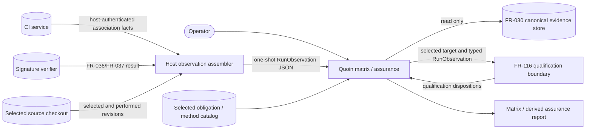

# Scope and boundary review of VER-97 read-time observations

## Summary

This review allocates the FR-153 responsibilities introduced by the change. Quoin owns parsing and validating its new read-time observation envelope, correlating it to one canonical record and selected obligation, and consuming the FR-116 qualification result for matrix and derived assurance reporting. The host owns admission and authentication of supplied CI, revision, signature and actor-authority observations. Quoin checks structure and correlation; it does not authenticate the host, contact CI, resolve Git state or run a signature verifier.

The change reads existing records and supplied observations. FR-030 storage, FR-184 record/output boundaries, AP-201 measurement collection/scoring and AP-202 Jev lens evaluation are outside the changed behavior. AP-201 nevertheless applies because the read-time qualification is rendered in retained-evidence reports and can affect decisions; its required evidence, integrity and scope-boundary analyses are part of this review.

## System Context

## In-Scope Responsibilities

- Validate the Quoin-owned observation envelope's member types, exact member sets, empty-value meanings and record path.
- Correlate a supplied observation only with its selected canonical record and derive the entry, obligation and method from that record and catalog.
- Supply typed, record-correlated observations to the FR-116 qualification boundary and render its dispositions in matrix and derived assurance views.
- Preserve the read-only FR-030/FR-184 store and report boundaries.

## External Dependencies

| Dependency | Type | Assumed or Guaranteed | Contract |
| --- | --- | --- | --- |
| Host observation assembler | Caller boundary | Assumed | FR-116 requires host admission of source, execution and actor observations; the new envelope validates shape and correlation but cannot authenticate the host. |
| CI service and selected checkout | External systems | Assumed through host | The host supplies the observed CI association and selected/performed revision; Quoin makes no CI or Git lookup. |
| Engineering-assurance signature verifier | External verification result | Assumed through host | A complete FR-036/FR-037 result is consumed as supplied evidence; Quoin does not run verification. |
| FR-030 evidence store | Canonical store | Guaranteed by existing contract | Read the selected canonical record; do not add fields, write records or change the legacy auditor. |
| Selected obligation/method catalog | Quoin catalog input | Guaranteed by existing contract | Derive the target, obligation and declared method from the selected record and catalog, not from observation-file choices. |
| FR-116 qualification boundary | Quoin owner contract | Assumed by specification; implementation planned | Consume typed `RunObservation` inputs and use its defined disposition vocabulary; this change does not redefine FR-116. No CLI wire-format contract test exists in this spec-only change. |

## Responsibility Allocation

| Requirement | Owning Component | Class |
| --- | --- | --- |
| FR-153-AC-12: observation transport and report entry point | Quoin matrix/assurance CLI | infrastructure |
| FR-153-AC-13: exact record and target correlation | Quoin analysis qualification bridge | core |
| FR-153-AC-14: revision observations and outcomes | Quoin analysis qualification bridge | core |
| FR-153-AC-15: CI association outcomes | Quoin analysis qualification bridge | core |
| FR-153-AC-16: signature-mapped actor authority | Quoin analysis qualification bridge | cross-cutting |
| FR-153-AC-17: protocol and shape refusal | Quoin matrix/assurance CLI | infrastructure |
| FR-153-CON-2: read-only counting and no solver execution | Quoin analysis qualification bridge | infrastructure |

## Findings

| ID | Severity | Summary | Refs |
| --- | --- | --- | --- |
| FND-001 | low | No scope-allocation issue found. Host authenticity remains an explicit FR-116 assumption, and the new JSON transport is allocated to Quoin without moving host verification into Quoin. | FR-116-CON-3, FR-153-AC-12–AC-17 |

## Verdict

The scope boundary and responsibility allocation are explicit for the changed FR-153 obligations. No FR-030/FR-184 persistence or output responsibility moves into this feature.

## Examined

FR-153 Inputs, Behavior, AC-12 through AC-17 and CON-1 through CON-3; FR-030-AC-1; FR-116 Inputs, actor/host boundary and CON-1 through CON-3; FR-184-CON-1; AP-201 applicability and review policy; AP-202 applicability.
