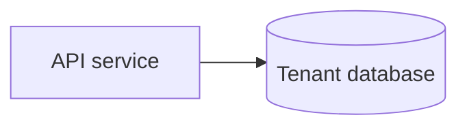

# Trusted service boundary

## Boundary



## Properties

| Field | Type | Multiplicity | Constraints |
|---|---|---|---|
| boundary_id | UUID | 1..1 | identity |
| trust_level | String | 1..1 | minLength: 1 |

## Invariants

The trusted service boundary limits access to the tenant database.

### TenantAccess

```ocl
context TrustedServiceBoundary
inv TenantAccess: true
```
